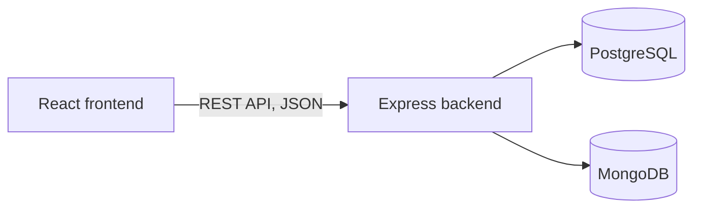

# EduWrap

**Study together. Stay consistent.**

EduWrap is a collaborative study platform for university cohorts. Students form study rooms, share flashcard decks, ask and answer doubts, and build a daily study habit through streaks, points and weekly leaderboards.

> Capstone project for **Advanced Programming (AP)** and **Data Engineering (DE)**
> B.Tech Computer Science & AI, Rishihood University, Batch 2025–29
> Team **T0055**, Section A

**Status:** in development. Planning, design and the database normalization (CP1) are complete. Implementation is in progress.

---

## The problem

In a university cohort, study help is scattered and disappears. Doubts get asked in chat groups, buried within an hour, and asked again next semester. Good notes and flashcards stay on one student's laptop, and nobody can tell which answer was correct.

EduWrap turns scattered peer help into a shared, searchable study base, and keeps students coming back with habit mechanics.

---

## Features

| Layer | What it includes |
|---|---|
| **Core** | Accounts and onboarding, study rooms, flashcard decks, practice sessions, doubt board with answers, upvotes and accepted answers, personal dashboard |
| **Growth** | Daily goal and streaks, points, weekly room leaderboard, notifications, activity feed |
| **Stretch** | Badges, deck cloning, keyboard shortcuts |

Highlights:

- **Rooms:** public or private groups for a course or study circle, joined by search or invite code.
- **Decks and practice:** shared flashcards with spaced repetition (five Leitner boxes), so cards you miss come back sooner.
- **Doubt board:** questions scoped to a room, with upvoted answers and one accepted answer. Any answer can be saved as a flashcard.
- **Habit loop:** a daily card goal, a streak, points for helping others, and a weekly leaderboard.

---

## Tech stack

| Area | Technology |
|---|---|
| Frontend | React.js, JavaScript, HTML5, CSS3, Tailwind CSS |
| Backend | Node.js, Express.js |
| Relational database | PostgreSQL (SQL) |
| Document database | MongoDB |

JavaScript is used throughout (no TypeScript), and dependencies are kept to the minimum.

### How the two databases are used

- **PostgreSQL** is the source of truth for structured, related data: users, rooms, memberships, decks, cards, review progress, doubts, answers, upvotes and points.
- **MongoDB** stores event-style data that grows quickly and has a flexible shape: study sessions, the activity feed, notifications and daily activity counters.



---

## Repository structure

The structure below is the target layout. Folders are added as each part is built.

```
EduWrap_AP_2026/
├── README.md
├── dbms/                  DBMS checkpoint submissions
│   └── 01_normalization.md
├── docs/                  PRD and design specification
├── AP/                    Advanced Programming: the application
│   ├── frontend/          React + Tailwind
│   └── backend/           Node.js + Express
└── DE/                    Data Engineering: database assets
    ├── postgres/          schema, seed data, queries
    ├── mongodb/           collections and indexes
    └── scripts/           reset and reseed helpers
```

---

## Documentation

| Document | Description | Status |
|---|---|---|
| [`dbms/01_normalization.md`](dbms/01_normalization.md) | Normalization from unnormalized design through 1NF, 2NF and 3NF, BCNF check, final schema and ER diagram | Complete |
| Product Requirements Document | Problem, users, scope, functional and non-functional requirements | Complete |
| Design specification | Visual system and design of every page | Complete |

---

## Academic checkpoints (DBMS)

| Checkpoint | Deliverable | Deadline | Status |
|---|---|---|---|
| CP1 | Schema and normalization | Nov 16, 2026 | Submitted |
| CP2 | Baseline timings | Nov 17, 2026 | Upcoming |
| CP3 | Optimization | Nov 19, 2026 | Upcoming |
| CP4 | Final submission | Nov 23, 2026 | Upcoming |
| CP5 | Individual analysis | Nov 25–26, 2026 | Upcoming |

---

## Getting started

The application is under development. Setup and run instructions will be added once the backend and frontend are in place.

**Prerequisites (planned):**

- Node.js (LTS)
- PostgreSQL
- MongoDB

---

## Concepts demonstrated

- **Node.js and Express:** routing, middleware (logging, authentication, error handling), REST design, status codes, environment variables.
- **PostgreSQL:** primary and foreign keys, constraints, many-to-many junction tables, joins, aggregation, indexes, transactions, cascading deletes.
- **Normalization:** 1NF, 2NF, 3NF and BCNF reasoning for every table.
- **MongoDB:** collections and documents, filters, upserts, aggregation and indexes.
- **React:** components, state, effects, routing and controlled forms.

---

## Team

Team **T0055**, Section A, Rishihood University.

| Name | Role |
|---|---|
| Vamsi Krishna | Project lead and backend (Node.js, Express, API design) |
| Shreya Das | Frontend and UI/UX (React, Tailwind CSS, design system) |
| Jayanth | Database (PostgreSQL schema and queries, MongoDB collections) |
| Mouli | Testing, documentation and integration (test cases, demo data, viva material) |

Every team member is expected to understand the full request flow, from the React page through Express to both databases.

---

## Notes

This repository contains only the EduWrap application. The separate Data Engineering assignment on a doctor appointments database is maintained elsewhere and is not part of this project.