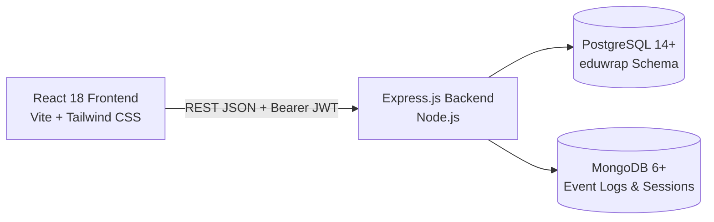

# EduWrap 2.0

**Study together. Stay consistent.**

EduWrap 2.0 is a collaborative study platform for university cohorts. Students form study rooms, share flashcard decks, ask and answer doubts, and build a daily study habit through spaced repetition (Leitner system), streaks, points, and weekly leaderboards.

> Capstone project for **Advanced Programming (AP)** and **Data Engineering (DE)**  
> B.Tech Computer Science & AI, Rishihood University, Batch 2025–29  
> Team **T0055**, Section A

**Status:** Complete & Operational. Dual-database backend (Node.js + Express), React frontend, normalized schema (3NF/BCNF), query workloads (CP1–CP3), and test suite are implemented and verified.

---

## The Problem

In a university cohort, study help is scattered and ephemeral. Doubts get posted in messaging groups, buried within an hour, and repeatedly re-asked next semester. Quality notes and flashcards remain siloed on individual laptops, and students struggle to maintain daily study consistency.

EduWrap 2.0 transforms fragmented peer interactions into a centralized, searchable academic knowledge base, driving retention through spaced repetition and social gamification.

---

## Features

| Layer | What It Includes |
|---|---|
| **Core** | Accounts (JWT + Google OAuth), study rooms (public & invite-code private), flashcard decks, 5-box Leitner spaced repetition practice, doubt board with answers, upvotes, accepted answers, and personal dashboard |
| **Growth** | Daily card goals (10/20/30/50), 7-day study streak, points ledger, weekly room & cohort leaderboards, notifications, activity feeds |
| **Stretch** | Badges ("First Answer", "7-Day Streak", "Helper", "Century"), card conversion from answers, keyboard shortcuts |

---

## Tech Stack & Architecture



- **Frontend:** React 18, Vite, React Router v6, Tailwind CSS, Lucide Icons, `@react-oauth/google`.
- **Backend:** Node.js, Express.js 4, `bcryptjs`, `jsonwebtoken`, `google-auth-library`.
- **PostgreSQL (Source of Truth):** 14 normalized relations in `eduwrap` schema for users, subjects, rooms, memberships, decks, cards, Leitner progress, doubts, answers, upvotes, points ledger, badges, and daily activity.
- **MongoDB (Event Layer):** High-throughput collections (`study_sessions`, `activity_events`, `notifications`) with an automatic in-memory fallback mode for resilient offline execution.

---

## Repository Structure

```
EduWrap_AP_2026/
├── README.md                                # Project overview, lifecycle notes & demo script
├── dbms/                                    # Academic DBMS deliverables (CP1–CP3)
│   ├── 01_normalization.md                  # Normalization (UNF → 1NF → 2NF → 3NF → BCNF)
│   ├── 02_er_diagram.png                    # Entity-Relationship diagram
│   ├── 03_schema.sql                        # PostgreSQL DDL (14 tables + constraints)
│   └── 04_queries.sql                       # 63 workload queries (28 READ + 35 WRITE)
├── md docs/                                 # Detailed project specifications & viva guides
│   ├── EduWrap 2.0 – Product Requirements Document.md
│   ├── eduwrap_2_0_light_theme_design_specification.md
│   ├── viva_sheet_request_lifecycle_and_concept_map.md
│   └── integration_check_dual_database.md
└── AP/                                      # Advanced Programming: Application codebase
    ├── backend/                             # Express REST API
    │   ├── server.js                        # Entry point & connection pooling
    │   ├── scripts/seed.js                  # Database reset & starter deck seed script
    │   ├── src/                             # Config, controllers, middleware, routes, utils
    │   └── tests/                           # Unit, integration & permission test suites
    └── frontend/                            # React 18 SPA (Vite + Tailwind)
```

---

## Academic Checkpoints (DBMS & AP)

| Checkpoint | Deliverable | Deadline | Status |
|---|---|---|---|
| **CP1** | Schema design & normalization ([`dbms/01_normalization.md`](dbms/01_normalization.md)) | Nov 16, 2026 | **Submitted** |
| **CP2** | ER diagram & schema DDL ([`dbms/03_schema.sql`](dbms/03_schema.sql)) | Nov 17, 2026 | **Submitted** |
| **CP3** | Query workload (63 queries) ([`dbms/04_queries.sql`](dbms/04_queries.sql)) | Nov 19, 2026 | **Submitted** |
| **CP4** | Final DBMS submission & execution verification | Nov 23, 2026 | **Prepared** |
| **CP5** | Individual analysis & viva defense | Nov 25–26, 2026 | **Prepared** |

---

## Getting Started (Run Locally)

### Prerequisites
- **Node.js** v18+ (tested on v26 LTS)
- **PostgreSQL** v14+ (running locally on port 5432)
- **MongoDB** v6+ (optional — server gracefully falls back to memory store if offline)

### 1. Database Setup
Ensure PostgreSQL is running and initialize the schema:
```bash
# Create database
psql -U postgres -c "CREATE DATABASE eduwrap;"

# Load schema DDL
psql -U postgres -d eduwrap -f dbms/03_schema.sql
```

### 2. Backend Setup
```bash
cd AP/backend
cp .env.example .env
npm install

# Seed demo users, rooms, doubts, review progress, and public starter decks:
npm run seed

# Run the test suite:
npm test

# Start backend server (starts on http://localhost:5001):
npm run dev
```

### 3. Frontend Setup
```bash
cd AP/frontend
cp .env.example .env
npm install

# Start development client (opens on http://localhost:3000 or http://localhost:5173):
npm run dev
```

---

## Concept Coverage & Request Lifecycle (Viva Preparation)

For the oral evaluation and viva defense, comprehensive documentation has been created:
- **[Viva Sheet & Concept Map](md%20docs/viva_sheet_request_lifecycle_and_concept_map.md):** Complete trace of requests through React → Express → PostgreSQL & MongoDB, normal form defenses (BCNF/3NF), and key architectural trade-offs.
- **[Dual-Database Integration & Resilience Guide](md%20docs/integration_check_dual_database.md):** Proof that streaks, daily goals, and points maintain ACID consistency in PostgreSQL even when MongoDB is disconnected.

---

## Live Evaluation Demo Script (5-Minute Walkthrough)

1. **Onboarding & Starter Decks:**
   - Sign up a new user or log in with demo credentials (`vamsi@eduwrap.io` / `password123`).
   - Notice onboarding starter decks created by `EduWrap Team` ("DBMS & SQL Quickstart", "Data Structures Fundamentals").
2. **Spaced Repetition Practice:**
   - Navigate to `/practice` and review due flashcards.
   - Flip cards (`Space`), select "Got It" (`2`) or "Missed" (`1`).
   - Observe immediate advancement of the Leitner box in PostgreSQL `card_progress` and increment in `daily_activity`.
3. **Collaborative Study Rooms & Doubts:**
   - Join "DBMS Masters (Section A)" via invite code `DBMS2026`.
   - Post a doubt, post an answer, and cast upvotes.
   - Accept an answer as author; verify **+15 points** recorded in `points_events` and enforced by partial unique index `uq_one_accepted_answer`.
   - Convert the accepted answer into a flashcard with one click (`cards.source_answer_id`).
4. **Weekly Leaderboard:**
   - Navigate to `/leaderboard` to view live dynamic rankings computed with PostgreSQL `DENSE_RANK() OVER (ORDER BY SUM(pe.points) DESC)`.

---

## Team

Team **T0055**, Section A, Rishihood University.

| Name | Role | Deliverables Owned |
|---|---|---|
| **Bala Vamsi Krishna** | Project Lead & Backend | Architecture, Express API, auth, routing, controllers, seed coordination |
| **Shreya Das** | Frontend & UI/UX | React 18, Tailwind design system, AppShell, page views, responsive layouts |
| **Jayanth Pranay Konada** | Database Engineering | PostgreSQL schema, normalization doc (CP1), DDL (CP2), query workload (CP3) |
| **Chekka Chandra Mouli** | Testing, Integration & Docs | Test suites, permission tests, starter decks seed, viva sheet, integration guide |
