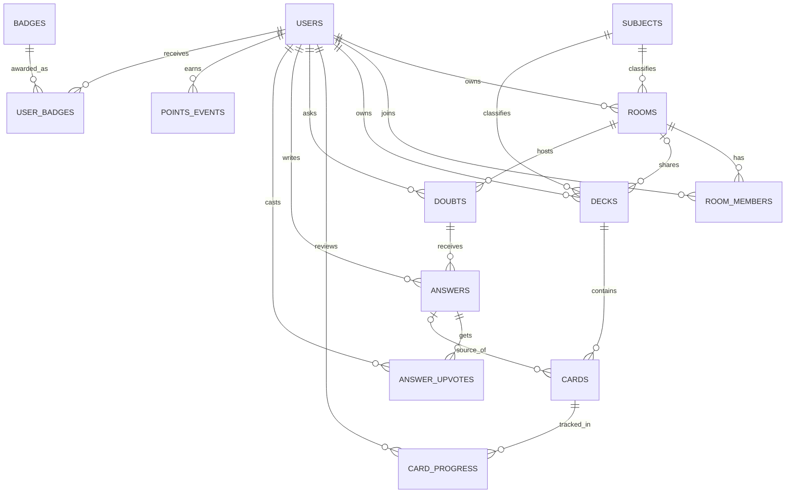

# EduWrap 2.0 – Data Normalization (CP1)

| | |
|---|---|
| **Project** | EduWrap 2.0, a collaborative study platform |
| **Course context** | Advanced Programming capstone, with Data Engineering concepts |
| **Team** | T0055, Section A |
| **Checkpoint** | CP1: Schema and normalization, due November 16, 2026 |
| **Database in scope** | PostgreSQL (relational core). MongoDB design notes are in section 11 |
| **Companion documents** | Product Requirements Document (PRD) and `design.md` |

This document shows how the EduWrap data model was derived by normalizing from an unnormalized design through 1NF, 2NF and 3NF, and then checked against BCNF. It ends with the final relational schema.

> The Practo Doctor Appointments database is a separate Data Engineering assignment. It is not part of this document.

---

## 1. Purpose and method

1. Start from the data the way a student would first keep it: a single wide sheet per area of the app (an **unnormalized** design).
2. List the functional dependencies (FDs) that hold in the real application.
3. Apply 1NF, 2NF and 3NF in order, showing which dependency forces each step.
4. Check every final relation against BCNF.
5. Record the deliberate design decisions, including the few places where we choose not to store or not to normalize something, and why.

**Notation.** `A → B` means A determines B. `{A, B}` is a composite key. *PK* means primary key and *FK* means foreign key.

---

## 2. Application data in scope

The data needed by the features in the PRD falls into four areas.

| Area | What is stored | PRD requirements |
|---|---|---|
| A. People, rooms and Q&A | Users, rooms, memberships, doubts, answers, upvotes | FR-A, FR-R, FR-Q |
| B. Decks and practice | Decks, cards, per-user review progress (Leitner boxes) | FR-D, FR-P |
| C. Points | A ledger of points earned | FR-G1, section 8 of the PRD |
| D. Badges (stretch) | Badge catalogue and awards | FR-G5 |

Event-style data (study sessions, activity feed, notifications, daily activity) is stored in MongoDB and is described in section 11.

---

## 3. Functional dependencies of the real world

These rules come from how EduWrap behaves. They drive every decomposition below.

**People and rooms**

- A user id determines the user's name, email, password hash, daily goal and join date.
- An email identifies exactly one user (`email → user_id`).
- A room id determines its name, description, subject, visibility, invite code and owner.
- An invite code identifies exactly one room (`invite_code → room_id`).
- A subject id determines the subject name, and a subject name identifies one subject.
- A user belongs to a room at most once, and the pair (room, user) determines the join date.

**Q&A**

- A doubt id determines its title, body, room, asker and creation time.
- An answer id determines its doubt, author, body, accepted flag and creation time.
- A user can upvote a given answer at most once, so the pair (answer, user) identifies an upvote.
- At most one answer of a doubt is accepted.

**Decks and practice**

- A deck id determines its title, description, subject, visibility, owner and room.
- A card id determines its deck, front, back and (optional) source answer.
- The pair (user, card) determines that user's Leitner box, due date and last review time.

**Points**

- A points event id determines its user, type, number of points, source and time.

---

## 4. Walkthrough A: people, rooms and Q&A

### 4.1 Unnormalized design (UNF)

The first idea is one sheet that lists each doubt with everything around it, including a repeating group of answers, and inside each answer a repeating group of upvoters.

**DoubtSheet** (doubt_id, doubt_title, doubt_body, asker_id, asker_name, asker_email, room_id, room_name, room_subject, room_owner_id, room_owner_name, **{answer_no, answer_body, answerer_id, answerer_name, is_accepted, {upvoter_id, upvoter_name}}**)

The braces mark repeating groups. Sample data:

| doubt_id | doubt_title | asker | room | answers (no, answerer, accepted, upvoters) |
|---|---|---|---|---|
| 101 | Why do we need 3NF? | 2, Ravi, ravi@mail | 10, DBMS Batch A, DBMS, owner 3 Meera | (1, Asha, yes, [Ravi, Meera]); (2, Meera, no, []) |
| 102 | PK vs UNIQUE? | 1, Asha, asha@mail | 10, DBMS Batch A, DBMS, owner 3 Meera | (1, Ravi, no, [Asha]) |

**Problems with this design**

| Anomaly | Example |
|---|---|
| **Update** | If Ravi changes his name, every doubt he asked and every answer he wrote and every upvote he cast must be updated. Missing one leaves two names for one person |
| **Insert** | A room cannot be stored until at least one doubt exists in it, because room data lives inside the doubt row |
| **Delete** | Deleting the only doubt in room 10 also deletes the only record that the room exists and who owns it |
| **Cannot be stored** | A cell holding a list of answers and upvoters cannot be searched, sorted by votes or constrained to one vote per person |

### 4.2 First Normal Form (1NF)

**Rule.** Every attribute holds a single atomic value, and there are no repeating groups. Each relation has a key.

**Action.** The repeating groups are removed into their own relations, linked back by the keys of the parent.

| Relation | Key | Attributes |
|---|---|---|
| **Doubt1** | doubt_id | doubt_title, doubt_body, asker_id, asker_name, asker_email, room_id, room_name, room_subject, room_owner_id, room_owner_name |
| **Answer1** | {doubt_id, answer_no} | answer_body, answerer_id, answerer_name, is_accepted |
| **Upvote1** | {doubt_id, answer_no, upvoter_id} | upvoter_name |

Result for the sample data:

**Doubt1**

| doubt_id | doubt_title | asker_id | asker_name | asker_email | room_id | room_name | room_subject | room_owner_id | room_owner_name |
|---|---|---|---|---|---|---|---|---|---|
| 101 | Why do we need 3NF? | 2 | Ravi | ravi@mail | 10 | DBMS Batch A | DBMS | 3 | Meera |
| 102 | PK vs UNIQUE? | 1 | Asha | asha@mail | 10 | DBMS Batch A | DBMS | 3 | Meera |

**Answer1**

| doubt_id | answer_no | answer_body | answerer_id | answerer_name | is_accepted |
|---|---|---|---|---|---|
| 101 | 1 | Because it removes transitive dependencies | 1 | Asha | yes |
| 101 | 2 | It avoids update anomalies | 3 | Meera | no |
| 102 | 1 | A PK cannot be NULL | 2 | Ravi | no |

**Upvote1**

| doubt_id | answer_no | upvoter_id | upvoter_name |
|---|---|---|---|
| 101 | 1 | 2 | Ravi |
| 101 | 1 | 3 | Meera |
| 102 | 1 | 1 | Asha |

All values are now atomic and a one-vote-per-person rule is possible. But the data is still repeated: the room details appear in every doubt row, and user names appear in every relation.

### 4.3 Second Normal Form (2NF)

**Rule.** The relation is in 1NF and no non-key attribute depends on only part of a composite key.

**Check.**

| Relation | Key | Partial dependency? |
|---|---|---|
| Doubt1 | doubt_id (single attribute) | Not possible. In 2NF by definition |
| Answer1 | {doubt_id, answer_no} | `answer_body, answerer_id, is_accepted` depend on the whole key. `answerer_name` depends on `answerer_id`, which is not part of the key. That is not a partial dependency but a transitive one, handled in 3NF |
| Upvote1 | {doubt_id, answer_no, upvoter_id} | **`upvoter_id → upvoter_name`**: `upvoter_name` depends on only one part of the key. This violates 2NF |

**Action.** Remove `upvoter_name` from Upvote1 and keep it in a Users relation.

**Upvote2** (doubt_id, answer_no, upvoter_id), PK: all three attributes.
**User** (user_id, user_name) receives the removed dependency.

Doubt1 and Answer1 remain as they were. All relations are now in 2NF.

### 4.4 Third Normal Form (3NF)

**Rule.** The relation is in 2NF and no non-key attribute depends on another non-key attribute (no transitive dependencies).

**Check and action.**

| Relation | Transitive dependency | Fix |
|---|---|---|
| Doubt1 | `doubt_id → asker_id → asker_name, asker_email` | Move name and email to **User**, keep `asker_id` as a foreign key |
| Doubt1 | `doubt_id → room_id → room_name, room_subject, room_owner_id` | Move room details to **Room**, keep `room_id` as a foreign key |
| Doubt1 | `room_id → room_owner_id → room_owner_name` | The owner name is already in **User**. Room keeps only `owner_id` |
| Answer1 | `{doubt_id, answer_no} → answerer_id → answerer_name` | Remove `answerer_name`. Keep `answerer_id` as a foreign key to **User** |

**Subjects.** `room_subject` depends only on `room_id`, so a Room relation is already in 3NF with it. We still introduce a **Subject** relation, because the same subject list is shared by rooms and decks and free text would allow spelling variants ("DBMS", "dbms", "Dbms"). This is a data integrity decision, not a 3NF requirement.

**Surrogate key.** The composite key {doubt_id, answer_no} is replaced by a single surrogate key `answer_id`. This simplifies the foreign keys of Upvote, and the pair (doubt_id, answer_no) is no longer needed. Upvote becomes {answer_id, user_id}.

**Membership.** A user belongs to many rooms and a room has many users. This many-to-many relationship needs its own relation, **RoomMember** {room_id, user_id}. It is not visible in the sample sheet because the sheet records only the owner, but FR-R2 and FR-R3 require it.

**Result of Walkthrough A (3NF):**

| Relation | PK | Other attributes | Foreign keys |
|---|---|---|---|
| User | user_id | name, email, password_hash, daily_goal, created_at | none |
| Subject | subject_id | name | none |
| Room | room_id | name, description, visibility, invite_code, created_at | subject_id, owner_id |
| RoomMember | {room_id, user_id} | joined_at | room_id, user_id |
| Doubt | doubt_id | title, body, created_at | room_id, author_id |
| Answer | answer_id | body, is_accepted, created_at | doubt_id, author_id |
| AnswerUpvote | {answer_id, user_id} | created_at | answer_id, user_id |

Each anomaly from section 4.1 is now gone:

| Anomaly | Why it is gone |
|---|---|
| Update | A name is stored once in User |
| Insert | A room exists independently of doubts |
| Delete | Deleting a doubt leaves the room and the owner untouched |
| Search and constrain | Answers and votes are rows, and the composite primary key allows one vote per user per answer |

---

## 5. Walkthrough B: decks, cards and practice progress

### 5.1 Unnormalized design (UNF)

**DeckSheet** (deck_id, deck_title, deck_description, subject_name, visibility, room_id, room_name, owner_id, owner_name, **{card_id, front, back, source_answer_id, {learner_id, learner_name, box, due_date, last_reviewed}}**)

| deck_id | deck_title | subject | visibility | room | owner | cards (and learners' progress) |
|---|---|---|---|---|---|---|
| 20 | Joins Basics | DBMS | room | 10, DBMS Batch A | 1, Asha | (501, "INNER JOIN?", "Rows matching in both tables", none, [Ravi box 2 due 17 Nov; Meera box 1 due 16 Nov]); (502, "LEFT JOIN?", "All left rows plus matches", answer 1 of doubt 101, [Ravi box 1 due 16 Nov]) |

**Anomalies:** a learner's name and a room's name are repeated in every card row. A card cannot be created before someone practises it if progress is stored inside the card. Deleting the last learner's progress would look like deleting the card.

### 5.2 First Normal Form (1NF)

Repeating groups become separate relations.

| Relation | Key | Attributes |
|---|---|---|
| **Deck1** | deck_id | deck_title, deck_description, subject_name, visibility, room_id, room_name, owner_id, owner_name |
| **Card1** | card_id | deck_id, front, back, source_answer_id |
| **Progress1** | {card_id, learner_id} | learner_name, box, due_date, last_reviewed |

Since `card_id` is unique across the system, Card1 does not need the deck in its key.

### 5.3 Second Normal Form (2NF)

| Relation | Partial dependency | Fix |
|---|---|---|
| Deck1, Card1 | Single-attribute keys, no partial dependencies | none |
| Progress1 | **`learner_id → learner_name`**: depends on part of the key {card_id, learner_id} | Move `learner_name` to **User** |

`box`, `due_date` and `last_reviewed` depend on the whole key because they describe one learner's history with one card.

### 5.4 Third Normal Form (3NF)

| Relation | Transitive dependency | Fix |
|---|---|---|
| Deck1 | `deck_id → owner_id → owner_name` | Keep `owner_id` as a foreign key to **User** |
| Deck1 | `deck_id → room_id → room_name` | Keep `room_id` as a foreign key to **Room** |
| Deck1 | `deck_id → subject_name` | Replace by `subject_id` referencing **Subject** (integrity, as in 4.4) |
| Card1 | `card_id → deck_id`, no non-key to non-key dependency | none |

**Visibility rule.** A deck has `visibility` of private, room or public, and `room_id` is required only when visibility is room. This is not a functional dependency, so it does not affect normal forms. It is enforced with a CHECK constraint: `room_id` is present exactly when visibility is room.

**Result of Walkthrough B (3NF):**

| Relation | PK | Other attributes | Foreign keys |
|---|---|---|---|
| Deck | deck_id | title, description, visibility, created_at | subject_id, owner_id, room_id (nullable) |
| Card | card_id | front, back, created_at | deck_id, source_answer_id (nullable) |
| CardProgress | {user_id, card_id} | box, due_date, last_reviewed | user_id, card_id |

---

## 6. Walkthrough C: points

### 6.1 Unnormalized design

**PointsSheet** (user_id, user_name, week_total, **{event_type, points, source_description, event_time}**)

**Problems:**

- `week_total` is a **derived value**: it equals the sum of the points in the same row's repeating group. Storing it means it can disagree with the events.
- `user_name` is repeated.
- Rows in a sheet cannot be removed individually when a source (such as an answer) is deleted.

### 6.2 Normalization

1. **1NF:** the repeating group becomes its own relation, **PointsEvent**, with its own key `event_id`.
2. **2NF:** the key is a single attribute, so no partial dependency is possible. `user_name` moves to **User** (a transitive dependency through `user_id`, resolved in 3NF).
3. **3NF:** `week_total` is removed from storage entirely, since it is a function of other data. Weekly and room totals are calculated with `SUM` and `GROUP BY` when needed.

### 6.3 A deliberate decision about the points column

In the current rules, `event_type → points` looks like a functional dependency (for example, an answer always gives +5). If it truly held, storing `points` on each row would be a transitive dependency.

We **keep `points` on each event** because the value is a fact about that event at the time it was awarded, not a property of the type:

- Rules can change later (for example, answers become worth +6), and history must not change retroactively.
- Some rules depend on context, not only the type (the first five doubts of a day score, later ones do not).

The alternative, a separate rule table keyed by event type, would be fully 3NF but would rewrite history when the rule changes. This choice will be explained during the viva.

### 6.4 Linking each event to its source

Each point award must disappear when its source is deleted (PRD section 8). A single generic "source id" column cannot have a real foreign key, so each source type has its own nullable column, and a CHECK constraint ensures that exactly the right columns are filled for each event type.

| event_type | Points to | Cascade |
|---|---|---|
| ask_doubt | `doubt_id` references Doubt | Deleted with the doubt |
| post_answer | `answer_id` references Answer | Deleted with the answer |
| answer_accepted | `answer_id` references Answer | Deleted with the answer |
| answer_upvoted | `{answer_id, voter_id}` references AnswerUpvote | Deleted when the vote is removed |
| session_completed | `session_ref`, the MongoDB id of the study session (text, no foreign key across databases) | None |
| daily_goal | `event_date` (one per user per day) | None |

**Result (3NF):** PointsEvent (event_id, user_id, event_type, points, doubt_id, answer_id, voter_id, session_ref, event_date, created_at).

---

## 7. Walkthrough D: badges (stretch)

**UNF:** BadgeSheet (user_id, user_name, {badge_name, badge_description, awarded_at}).

- **1NF:** repeating badge group separated.
- **2NF:** `badge_name → badge_description` is a partial dependency of the key {user_id, badge_name}. Badge details move to **Badge** (badge_id, name, description).
- **3NF:** `user_name` stays in User. The award itself becomes **UserBadge** {user_id, badge_id} with `awarded_at`.

A many-to-many relationship between users and badges, with the pair as the key.

---

## 8. Final relational schema (3NF, BCNF verified)

### 8.1 Entity relationship diagram

### 8.2 Tables

Type notation: **int** = integer with an identity (auto-generated) key, **text**, **bool**, **date**, **timestamp** = timestamp with time zone.

**users**

| Column | Type | Constraints |
|---|---|---|
| user_id | int | PRIMARY KEY |
| name | text | NOT NULL, 2 to 60 characters |
| email | text | NOT NULL, UNIQUE |
| password_hash | text | NOT NULL |
| daily_goal | int | NOT NULL, DEFAULT 20, CHECK in (10, 20, 30, 50) |
| created_at | timestamp | NOT NULL, DEFAULT now |

**subjects**

| Column | Type | Constraints |
|---|---|---|
| subject_id | int | PRIMARY KEY |
| name | text | NOT NULL, UNIQUE |

**rooms**

| Column | Type | Constraints |
|---|---|---|
| room_id | int | PRIMARY KEY |
| name | text | NOT NULL, 3 to 50 characters |
| description | text | up to 200 characters |
| subject_id | int | NOT NULL, FOREIGN KEY to subjects |
| visibility | text | NOT NULL, CHECK in (public, private) |
| invite_code | text | NOT NULL, UNIQUE, 8 characters |
| owner_id | int | NOT NULL, FOREIGN KEY to users |
| created_at | timestamp | NOT NULL, DEFAULT now |

**room_members** (junction)

| Column | Type | Constraints |
|---|---|---|
| room_id | int | FOREIGN KEY to rooms, ON DELETE CASCADE |
| user_id | int | FOREIGN KEY to users, ON DELETE CASCADE |
| joined_at | timestamp | NOT NULL, DEFAULT now |
| | | PRIMARY KEY (room_id, user_id) |

**decks**

| Column | Type | Constraints |
|---|---|---|
| deck_id | int | PRIMARY KEY |
| title | text | NOT NULL, 3 to 80 characters |
| description | text | optional |
| subject_id | int | NOT NULL, FOREIGN KEY to subjects |
| visibility | text | NOT NULL, CHECK in (private, room, public) |
| owner_id | int | NOT NULL, FOREIGN KEY to users, ON DELETE CASCADE |
| room_id | int | nullable, FOREIGN KEY to rooms, ON DELETE SET NULL |
| created_at | timestamp | NOT NULL, DEFAULT now |
| | | CHECK: room_id is present exactly when visibility is room |

If a room is deleted, its decks stay with their owners and become private (the application sets visibility to private in the same transaction).

**cards**

| Column | Type | Constraints |
|---|---|---|
| card_id | int | PRIMARY KEY |
| deck_id | int | NOT NULL, FOREIGN KEY to decks, ON DELETE CASCADE |
| front | text | NOT NULL, up to 500 characters |
| back | text | NOT NULL, up to 1000 characters |
| source_answer_id | int | nullable, FOREIGN KEY to answers, ON DELETE SET NULL |
| created_at | timestamp | NOT NULL, DEFAULT now |

**card_progress** (junction with attributes)

| Column | Type | Constraints |
|---|---|---|
| user_id | int | FOREIGN KEY to users, ON DELETE CASCADE |
| card_id | int | FOREIGN KEY to cards, ON DELETE CASCADE |
| box | int | NOT NULL, DEFAULT 1, CHECK between 1 and 5 |
| due_date | date | NOT NULL |
| last_reviewed | timestamp | nullable |
| | | PRIMARY KEY (user_id, card_id) |

**doubts**

| Column | Type | Constraints |
|---|---|---|
| doubt_id | int | PRIMARY KEY |
| room_id | int | NOT NULL, FOREIGN KEY to rooms, ON DELETE CASCADE |
| author_id | int | NOT NULL, FOREIGN KEY to users, ON DELETE CASCADE |
| title | text | NOT NULL, 10 to 150 characters |
| body | text | up to 2000 characters |
| created_at | timestamp | NOT NULL, DEFAULT now |

**answers**

| Column | Type | Constraints |
|---|---|---|
| answer_id | int | PRIMARY KEY |
| doubt_id | int | NOT NULL, FOREIGN KEY to doubts, ON DELETE CASCADE |
| author_id | int | NOT NULL, FOREIGN KEY to users, ON DELETE CASCADE |
| body | text | NOT NULL, up to 2000 characters |
| is_accepted | bool | NOT NULL, DEFAULT false |
| created_at | timestamp | NOT NULL, DEFAULT now |
| | | UNIQUE partial index on doubt_id where is_accepted is true (at most one accepted answer per doubt) |

**answer_upvotes** (junction)

| Column | Type | Constraints |
|---|---|---|
| answer_id | int | FOREIGN KEY to answers, ON DELETE CASCADE |
| user_id | int | FOREIGN KEY to users, ON DELETE CASCADE |
| created_at | timestamp | NOT NULL, DEFAULT now |
| | | PRIMARY KEY (answer_id, user_id). The application also blocks upvoting your own answer |

**points_events**

| Column | Type | Constraints |
|---|---|---|
| event_id | int | PRIMARY KEY |
| user_id | int | NOT NULL, FOREIGN KEY to users, ON DELETE CASCADE |
| event_type | text | NOT NULL, CHECK in (ask_doubt, post_answer, answer_upvoted, answer_accepted, session_completed, daily_goal) |
| points | int | NOT NULL |
| doubt_id | int | nullable, FOREIGN KEY to doubts, ON DELETE CASCADE |
| answer_id | int | nullable, FOREIGN KEY to answers, ON DELETE CASCADE |
| voter_id | int | nullable. With answer_id forms a FOREIGN KEY to answer_upvotes (answer_id, user_id), ON DELETE CASCADE |
| session_ref | text | nullable, MongoDB study session id |
| event_date | date | nullable, used for daily_goal |
| created_at | timestamp | NOT NULL, DEFAULT now |
| | | CHECK: the source columns that are filled match event_type (section 6.4). UNIQUE (user_id, event_date) for daily_goal events |

**badges** and **user_badges** (stretch)

| Table | Columns | Constraints |
|---|---|---|
| badges | badge_id, name, description | PRIMARY KEY (badge_id), name UNIQUE |
| user_badges | user_id, badge_id, awarded_at | PRIMARY KEY (user_id, badge_id), both FOREIGN KEY with ON DELETE CASCADE |

### 8.3 Derived values that are deliberately not stored

Storing these would create update anomalies, so each is computed by query.

| Value | Computed from |
|---|---|
| Answer count of a doubt | COUNT over answers |
| Upvote count of an answer | COUNT over answer_upvotes |
| Whether a doubt is answered or accepted | EXISTS over answers, and is_accepted |
| Member count of a room | COUNT over room_members |
| Cards due today | card_progress where due_date is today or earlier |
| Weekly points and leaderboard rank | SUM and GROUP BY over points_events, joined to room_members |
| Total points of a user | SUM over points_events |
| Streak and daily goal progress | MongoDB `daily_activity` |

---

## 9. BCNF verification

**Rule.** For every non-trivial functional dependency X → Y in a relation, X must be a superkey. 3NF allows an exception when Y is part of a candidate key, so BCNF is the stricter test.

| Relation | Candidate keys | Non-trivial dependencies | BCNF? |
|---|---|---|---|
| users | user_id, email | user_id → all, email → all | Yes. Both determinants are keys |
| subjects | subject_id, name | subject_id ↔ name | Yes |
| rooms | room_id, invite_code | room_id → all, invite_code → all | Yes |
| room_members | {room_id, user_id} | key → joined_at | Yes |
| decks | deck_id | deck_id → all | Yes |
| cards | card_id | card_id → all | Yes |
| card_progress | {user_id, card_id} | key → box, due_date, last_reviewed | Yes |
| doubts | doubt_id | doubt_id → all | Yes |
| answers | answer_id | answer_id → all | Yes |
| answer_upvotes | {answer_id, user_id} | key → created_at | Yes |
| points_events | event_id | event_id → all | Yes |
| badges | badge_id, name | badge_id ↔ all, name ↔ all | Yes |
| user_badges | {user_id, badge_id} | key → awarded_at | Yes |

**Conclusion.** Every determinant is a candidate key in every relation, so the schema is in **BCNF** and no further decomposition is needed. No dependency exists that satisfies 3NF but violates BCNF (the usual cause is overlapping composite candidate keys, which this schema does not have).

**Constraints that are not functional dependencies.** These rules are enforced by constraints and not by decomposition:

- At most one accepted answer per doubt (partial unique index).
- Deck room is present exactly when visibility is room (CHECK).
- One upvote per user per answer (composite primary key).
- Points event source columns match its type (CHECK).
- A user cannot upvote their own answer, and only the asker can accept an answer. These are authorization rules checked in the Express controllers.

---

## 10. Intentional design decisions

| Decision | Reason | Trade-off |
|---|---|---|
| Surrogate integer keys for all main entities | Short, stable foreign keys, no business value in keys | Needs UNIQUE on natural keys such as email and invite code |
| Subject as its own table | One shared list for rooms and decks, no spelling variants | One extra join |
| Room owner stored in `rooms.owner_id`, and also inserted into `room_members` | Fast permission checks and uniform "list members" queries | The owner appears in both places. The two inserts happen in one transaction |
| `points` stored on each event | History must not change when rules change (section 6.3) | Not strictly 3NF-pure if the rule never changed |
| Points sourced by separate nullable foreign keys | Real foreign keys give automatic cascade on delete | A few nullable columns and a CHECK constraint |
| Leaderboard computed from members' points | A member's points belong to the user, not to a room, so no room_id on the event | A user's points before joining a room count toward that room |
| Counts and totals never stored | No update anomalies | Aggregate queries (indexed in CP3) |
| `source_answer_id` on cards set to NULL on answer deletion | A card the user saved remains useful if the answer is later removed | The link to the original answer is lost |

---

## 11. MongoDB design notes

MongoDB stores event-style data. The collections are not normalized in the relational sense. They follow document-modelling rules instead.

| Collection | Design | Reason |
|---|---|---|
| study_sessions | One document per session, with an **embedded** array of at most 20 card results | The cards are always read with their session and the array is bounded |
| activity_events | One document per event, with ids that **reference** PostgreSQL rows and a short text summary stored as a snapshot | The summary is history ("Asha asked ...") and should not change if a title is later edited |
| notifications | One document per recipient and event, with a read flag | Frequently queried by recipient and unread status |
| daily_activity | One document per user per day, upserted | Streak, goal progress and weekly chart are read from these |

Relationship rules between the two databases:

1. PostgreSQL is written first, then MongoDB.
2. Documents store PostgreSQL ids, never copies of changeable data such as names. Names are looked up when displayed.
3. The only intentional snapshots are the text summaries in activity_events.
4. If a MongoDB write fails, the main action still succeeds and the error is logged.

---

## 12. Traceability to the PRD

| PRD area | Tables |
|---|---|
| Accounts, onboarding, profile (FR-A) | users |
| Rooms (FR-R) | rooms, room_members, subjects |
| Decks and cards (FR-D) | decks, cards, subjects |
| Practice and spaced repetition (FR-P) | card_progress, cards (plus MongoDB study_sessions) |
| Doubts, answers, upvotes, save as card (FR-Q) | doubts, answers, answer_upvotes, cards.source_answer_id |
| Points and leaderboard (FR-G1, FR-G4) | points_events, room_members |
| Badges (FR-G5, stretch) | badges, user_badges |
| Notifications and activity (FR-N) | MongoDB only |

**Differences from the PRD's section 12.2 table list:** `points_events` no longer has a `room_id` column (leaderboards join through `room_members`), and the generic `source_type` and `source_id` pair is replaced by explicit source foreign keys so that cascades are enforced by the database. The PRD should be updated to match.

---

## 13. Summary

- **Starting point:** wide, repeating-group sheets with update, insert and delete anomalies.
- **1NF:** repeating groups removed into separate relations.
- **2NF:** partial dependencies removed (`upvoter_name`, `learner_name`, badge details).
- **3NF:** transitive dependencies removed (asker, owner, room and subject details), derived data not stored.
- **BCNF:** verified for all 13 relations.
- **Result:** 11 core tables plus 2 stretch tables, with primary keys, foreign keys, cascades, CHECK and UNIQUE constraints that enforce the application rules in the database itself.

*The SQL script that creates this schema is a separate deliverable and follows from this document.*
