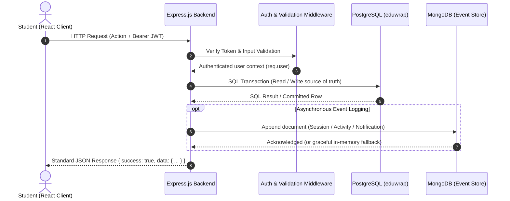

# EduWrap 2.0 — Viva Sheet: Request Lifecycle & Concept Map
**Author:** Chekka Chandra Mouli (Mouli) — Testing, Integration & Documentation (Team T0055)  
**Academic Checkpoint Deliverable:** Viva Preparation & Concept Coverage (AP & DE Capstone)

---

## 1. Executive Summary & Architecture Overview

EduWrap 2.0 implements a dual-database architecture:
- **PostgreSQL (`eduwrap` schema):** Relational source of truth for all structured, relational entities (Users, Subjects, Rooms, Memberships, Decks, Cards, Progress, Doubts, Answers, Upvotes, Points Ledger, Badges, Daily Activity).
- **MongoDB:** Flexible event logging and high-frequency document store (`study_sessions`, `activity_events`, `notifications`).



---

## 2. Request Lifecycle per Feature (End-to-End Traces)

### Feature 1: Authentication & Onboarding (FR-A)
- **User Action:** Student signs up on `RegisterPage.jsx` with name, email, password, and daily card goal (e.g., 20).
- **React Client:** Calls `api.post('/auth/register', payload)` from `client.js`. Sets `token` and `user` in `AuthContext.jsx`.
- **Express Route & Middleware:** `POST /api/auth/register` via `auth.routes.js`.
- **Controller (`auth.controller.js`):**
  1. Validates inputs (`daily_goal IN (10, 20, 30, 50)`).
  2. Hashes password using `bcryptjs.hash(password, 10)`.
  3. Executes PostgreSQL query:
     ```sql
     INSERT INTO users (name, email, password_hash, daily_goal)
     VALUES ($1, $2, $3, $4) RETURNING user_id, name, email, daily_goal, created_at;
     ```
  4. Generates 24-hour signed JWT: `jwt.sign({ userId, email }, JWT_SECRET, { expiresIn: '24h' })`.
  5. Logs non-blocking event to MongoDB `activity_events`.
- **Response:** Returns `201 Created` with token and user object.

---

### Feature 2: Flashcard Practice & Spaced Repetition (FR-P)
- **User Action:** Student flips cards and clicks "Got It" or "Missed" on `PracticePage.jsx`.
- **React Client:** Submits review batch via `POST /api/practice/session`.
- **Express Route & Middleware:** `POST /api/practice/session` protected by `auth.js` middleware (verifies Bearer JWT).
- **Controller (`practice.controller.js`):**
  1. Starts PostgreSQL transaction (`BEGIN`).
  2. For each card reviewed:
     - Uses `leitner.js` to compute `nextBox` and `dueDate`:
       - Got It: `nextBox = min(currentBox + 1, 5)`, interval = `[1, 2, 4, 8, 16]` days.
       - Missed: `nextBox = 1`, interval = 1 day.
     - Executes UPSERT query:
       ```sql
       INSERT INTO card_progress (user_id, card_id, box, due_date, last_reviewed)
       VALUES ($1, $2, $3, $4, now())
       ON CONFLICT (user_id, card_id)
       DO UPDATE SET box = EXCLUDED.box, due_date = EXCLUDED.due_date, last_reviewed = now();
       ```
  3. Updates daily counters in `daily_activity`:
     ```sql
     INSERT INTO daily_activity (user_id, activity_date, cards_reviewed, sessions_count)
     VALUES ($1, CURRENT_DATE, $2, 1)
     ON CONFLICT (user_id, activity_date)
     DO UPDATE SET cards_reviewed = daily_activity.cards_reviewed + EXCLUDED.cards_reviewed,
                   sessions_count = daily_activity.sessions_count + 1;
     ```
  4. Awards study session points (+10 pts) in `points_events`.
  5. Checks if `daily_goal` reached today; if yes, awards +10 pts (`uq_pe_daily_goal` ensures once/day).
  6. Commits PostgreSQL transaction (`COMMIT`).
  7. Inserts full study session history document into MongoDB `study_sessions`.
- **Response:** Returns `200 OK` with updated session stats, points earned, and daily goal status.

---

### Feature 3: Doubt Board, Upvoting & Card Conversion (FR-Q)
- **User Action 1 (Post Doubt):** Asker submits question in `RoomDetailPage.jsx` (Doubt tab).
  - SQL: `INSERT INTO doubts (room_id, author_id, title, body) VALUES ($1, $2, $3, $4) RETURNING doubt_id;`
  - Points: `INSERT INTO points_events (user_id, event_type, points, doubt_id) VALUES ($1, 'ask_doubt', 2, $2);` (+2 pts).
- **User Action 2 (Accept Answer):** Question asker accepts peer answer.
  - Verification: Controller verifies `req.user.user_id === doubt.author_id` (403 Forbidden otherwise).
  - SQL Transaction:
    ```sql
    UPDATE answers SET is_accepted = false WHERE doubt_id = $1 AND is_accepted = true;
    UPDATE answers SET is_accepted = true WHERE answer_id = $2 RETURNING author_id;
    INSERT INTO points_events (user_id, event_type, points, answer_id) VALUES ($3, 'answer_accepted', 15, $2);
    ```
- **User Action 3 (Save as Flashcard):** Student converts accepted answer into personal flashcard.
  - SQL:
    ```sql
    INSERT INTO cards (deck_id, front, back, source_answer_id)
    VALUES ($1, $2, $3, $4) RETURNING card_id;
    ```
  - Referential Integrity: If answer is ever deleted, `source_answer_id` is set to `NULL` via `ON DELETE SET NULL`, preserving the card.

---

### Feature 4: Weekly Room & Cohort Leaderboard (FR-G4)
- **User Action:** Student navigates to `LeaderboardPage.jsx`.
- **Express Route:** `GET /api/leaderboard/room/:roomId` or `GET /api/leaderboard/cohort`.
- **Controller (`leaderboard.controller.js`):**
  - Executes dynamic window aggregation:
    ```sql
    SELECT rm.user_id,
           u.name AS member_name,
           COALESCE(SUM(pe.points), 0) AS weekly_points,
           DENSE_RANK() OVER (ORDER BY COALESCE(SUM(pe.points), 0) DESC) AS rank
    FROM room_members rm
    JOIN users u ON u.user_id = rm.user_id
    LEFT JOIN points_events pe
           ON pe.user_id = rm.user_id
          AND pe.created_at >= date_trunc('week', CURRENT_TIMESTAMP)
    WHERE rm.room_id = $1
    GROUP BY rm.user_id, u.name
    ORDER BY rank ASC, u.name ASC;
    ```
- **Response:** Returns ranked list with member positions, points earned this week, and viewer's rank.

---

## 3. Academic Concept Map per Feature

| Feature | AP Programming Concepts | Relational DBMS Concepts (PostgreSQL) | Document / NoSQL Concepts (MongoDB) | Normal Form Justification |
|---|---|---|---|---|
| **Auth & Profile (FR-A)** | JWT authentication, bcrypt salt rounds, middleware chaining, CORS | Candidate keys (`user_id`, `email`), `CHECK (daily_goal IN (...))` | Snapshot profile caching | **BCNF**: Both determinants `user_id` and `email` are candidate keys. |
| **Study Rooms (FR-R)** | REST routing, param validation, authorization checks | Foreign keys, composite primary key `(room_id, user_id)`, `ON DELETE CASCADE` | Room activity stream | **3NF**: Junction relation resolves M:N without repeating groups. |
| **Decks & Cards (FR-D)** | Nested resource controllers, error propagation | Check constraint for room-deck relationship, `ON DELETE SET NULL` on `source_answer_id` | Starter deck metadata | **3NF**: Decks and cards normalized; deck determines subject and owner. |
| **Spaced Repetition (FR-P)** | Pure algorithm utility (`leitner.js`), date math, state machine | Composite key `(user_id, card_id)`, check constraint `box BETWEEN 1 AND 5` | Embedded card results in `study_sessions` document | **3NF**: Progress attributes depend fully on composite key. |
| **Doubts & Answers (FR-Q)** | Permission guards (asker only accept), conditional points | Partial unique index (`uq_one_accepted_answer`), composite FK `(answer_id, voter_id)` | Notification dispatch on accepted answer | **BCNF**: `doubt_id` determines room/author; `answer_id` determines answer. |
| **Points Ledger (FR-G1)** | Ledger architecture, event sourcing pattern | Explicit nullable FKs, check constraints enforcing source type, `uq_pe_daily_goal` | Snapshot activity summaries | **Deliberate Design**: `points` stored directly on event to preserve history. |
| **Leaderboard (FR-G4)** | Array filtering, rank mapping | Window functions (`DENSE_RANK()`), `date_trunc('week')`, `COALESCE` | Cache for fast top-10 retrieval | **Derived Value**: Computed dynamically; no update anomalies. |

---

## 4. Viva Defense FAQ (Key Technical Decisions)

### Q1: Why store `points` on `points_events` instead of referencing a points rule table?
**Answer:** In pure 3NF, if `event_type -> points` is constant, storing points on each row looks like a transitive dependency. However, storing points on each event is an intentional domain design decision: **historical points must never change when gamification rules are adjusted in the future**. If answers were +5 points today and changed to +10 points next semester, a pure rule join would retroactively rewrite students' past points.

### Q2: Why is `daily_activity` in PostgreSQL while `study_sessions` is in MongoDB?
**Answer:** `daily_activity` holds deterministic counters (`cards_reviewed`, `sessions_count`) needed for relational transactions (streaks, daily goal checks, and profile totals) with strict ACID guarantees. In contrast, `study_sessions` contains large, variable-length arrays of per-card response telemetry that grow rapidly and are read as a complete document when viewing session logs.

### Q3: How is MongoDB failover handled?
**Answer:** PostgreSQL is always written first. If MongoDB is offline, `AP/backend/src/config/mongo.js` catches the error and activates an in-memory fallback layer. Core actions (reviewing cards, posting doubts, earning points) succeed without disruption, satisfying High Availability (HA) requirements.
